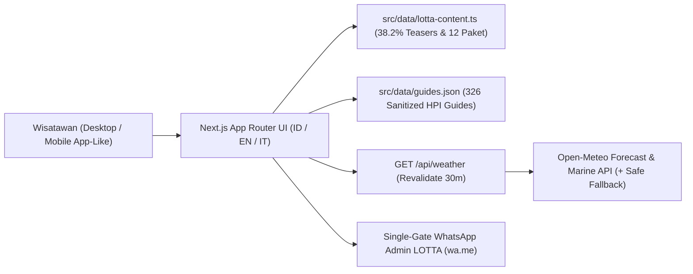

# Architecture Overview — LOTTA (`Next.js App Router`)

## 1. Tech Stack Utama
- **Framework**: Next.js 15+ (App Router, React 19, TypeScript strict mode).
- **Styling**: Tailwind CSS dengan token warna terkunci **V5 Clean Forest & Sage** (`#1A3A26`, `#2B4F39`, `#5F8D70`, `#4D775C`, `#A8CBB8`, `#D4E4DC`, `#E6EFEA`, `#F8F9F5`, `#F1F4EE`, `#C5D6CC`, `#9AB0A3`).
- **Font**: `Plus Jakarta Sans` via `next/font/google`.
- **Data Layer (Zero-Admin Architecture)**:
  - [`src/data/guides.json`](../src/data/guides.json): Data statis 326 Guide resmi DPD HPI NTB yang telah disanitasi (tanpa nomor telepon pribadi, alamat, atau nomor KTA).
  - `src/data/lotta-content.ts`: Kamus 3 bahasa (`ID`, `EN`, `IT`), daftar *Story Trailers* (`38.2% : 61.8%`), dan 12 paket wisata pada 3 Pilar & 4 Kabupaten.
- **Server-Side Weather & Marine Proxy**:
  - `src/app/api/weather/route.ts`: Route Handler Next.js yang mengambil data dari Open-Meteo Forecast API & Marine API dengan caching ISR (`next: { revalidate: 1800 }`) dan *fallback* otomatis bila jaringan eksternal lambat/offline.
- **Testing & Gate Pipeline**:
  - `lint`: ESLint + aturan larangan ikon/emoji.
  - `typecheck`: `tsc --noEmit`.
  - `unit`: Vitest + React Testing Library (menguji filter 326 Guide, privasi data, i18n `ID/EN/IT`, dan rasio Story Trailer).
  - `build`: `next build`.
  - `e2e`: Playwright / Vitest E2E (menguji alur Desktop Full-Width & Mobile Bottom Nav / Bottom Sheet).

---

## 2. Diagram Alur Sistem

