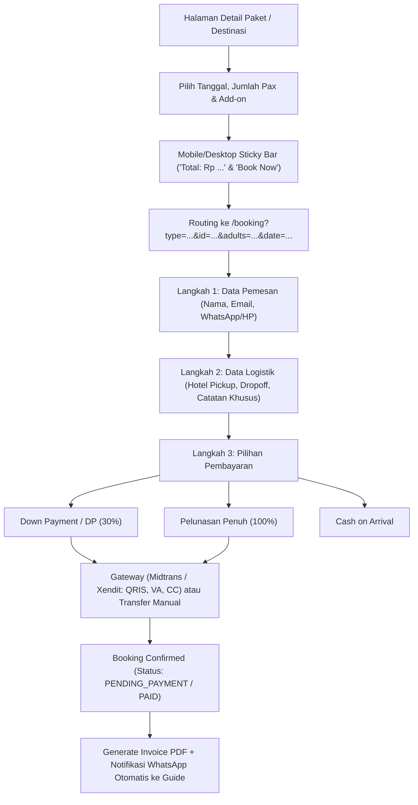

# Blueprints & Benchmark: Oby Lombok Tour (`obylomboktour.com`)
**LOTTA Architecture Upgrade & Market Pricing Reference**
*Dokumen ini disimpan sebagai arsip blueprint implementasi flow booking komersial dan arsitektur Multi-Level User untuk ekspansi platform LOTTA mendatang.*

---

## 1. Ringkasan Eksekutif & Komparasi Model Bisnis

| Parameter | Oby Lombok Tour (`obylomboktour.com`) | LOTTA Network (`lotta-web`) |
| :--- | :--- | :--- |
| **Model Utama** | Agen Perjalanan / Tour Operator Komersial Pribadi. | Otoritas Jaringan Pemandu Resmi (326 Guide HPI) & *Living Heritage*. |
| **Frontend Stack** | Next.js (App Router, Turbopack, Plus Jakarta Sans). | Next.js 15 (App Router, Plus Jakarta Sans, Tailwind, Zero-Slop). |
| **Backend Stack** | PHP/Laravel REST API terpisah (`api.obylomboktour.com`). | Next.js Serverless API Routes (`/api/weather`, JSON Catalog). |
| **Pemesanan** | Form Web Checkout multi-step + Midtrans/Transfer Bank + WhatsApp Fallback. | One-Gate WhatsApp Booking dengan Auto-Sync Destinasi & Ringkasan Rute. |
| **Akun Pengguna** | Multi-User (Login, Register, Dashboard, Riwayat Pesanan). | Single/Public Access (tanpa registrasi wajib, fokus pada kemudahan & privasi wisatawan). |

---

## 2. Benchmark Harga Destinasi & Paket Wisata (Data Pasar Riil Lombok)

*Data harga riil hasil inspeksi basis data produksi `api.obylomboktour.com`:*

### A. Paket Tur Darat & Air Terjun (Day Tours)
1. **Sasak Culture & Waterfalls**: `Rp 750.000` / pax (Min. 2 pax) — Sade, Sukarara, Tanjung Aan, Air Terjun Benang Stokel.
2. **Explore South Beach**: `Rp 700.000` / pax (Min. 2 pax) — Pantai Kuta Mandalika, Bukit Merese, Seger, Mawun.
3. **Explore North Lombok (Sendang Gile & Tiu Kelep)**: `Rp 855.000 – Rp 950.000` / pax — Air terjun kaki Rinjani.
4. **Tetebatu Green Hiking Trails**: `Rp 950.000` / pax — Persawahan bertingkat, kebun rempah, monyet hitam.
5. **Explore Pink Beach (Tangsi) & Tanjung Ringgit**: `Rp 1.250.000` / pax — Pasir merah muda & tebing purba Lombok Timur.

### B. Paket Snorkeling & Pulau (Gili Island Hopping)
1. **Explore Secret Gili (Sekotong)**: `Rp 800.000` / pax — Gili Kedis, Gili Nanggu, Gili Sudak.
2. **Private 5 Secret Gilis Tour**: `Rp 950.000` / pax — Eksplorasi pulau tak berpenghuni Sekotong Barat Daya.
3. **Sunset & Snorkeling Secret Gili**: `Rp 1.300.000` / pax — Trip sore & makan malam seafood pantai.
4. **North Gili Snorkeling Trip (Gili T, Meno, Air)**: `Rp 1.200.000` / pax — Patung bawah air Bask Nest & penyu karang.
5. **Gili Kondo & Gili Bidara Snorkeling**: `Rp 1.600.000` / pax — Lombok Timur trip pulau karang perawan.
6. **East Gilis Camping & Snorkeling (2D1N)**: `Rp 2.600.000` / pax (Min. 8 pax) — Camping tenda pantai di Gili Kondo.

### C. Paket Pendakian & Gunung (Trekking)
1. **Soft Trekking Orong Bukal**: `Rp 650.000` / pax.
2. **Anak Dara Hill Adventure (2D1N)**: `Rp 1.850.000` / pax — Sunrise camping Sembalun.
3. **Bukit Pergasingan Trekking (2D1N)**: `Rp 1.900.000` / pax — Panorama petak sawah Sembalun.
4. **Mount Rinjani Summit (2D1N Sharing Group)**: `Rp 3.100.000` / pax — Rim Senaru / Pelawangan Sembalun.
5. **Sumbawa Whale Shark Expedition (2D1N)**: `Rp 4.500.000` / pax — Teluk Saleh hiu paus.

### D. Aktivitas Wisata (Add-ons)
* **Surfing Lesson (Pantai Selong Belanak / Kuta)**: `Rp 350.000` / orang (1 jam).
* **Lombok Rafting Adventure**: `Rp 350.000` / orang.
* **ATV Adventure (Lombok Tengah)**: `Rp 300.000 – Rp 500.000` / orang (1.5 jam).
* **Traditional Sasak Cooking Class (Desa Bojeruk)**: `Rp 500.000` / orang.
* **Jetski Trip (Pantai Senggigi / Mandalika)**: `Rp 500.000` / orang (15 menit).
* **Lombok Tandem Paragliding (Bukit Merese / Sembalun)**: `Rp 650.000 – Rp 850.000` / orang.
* **Private Fun Fishing Trip**: `Rp 1.700.000` / boat.

### E. Charter Private Boat (Penyeberangan Cepat)
* **Teluk Nare ⇄ Gili Trawangan**: `Rp 400.000` / boat (One-Way, kapasitas 1-5 orang, 10-15 menit).
* **Teluk Nare ⇄ Gili Meno**: `Rp 400.000` / boat (One-Way).
* **Teluk Nare ⇄ Gili Air**: `Rp 400.000` / boat (One-Way).

---

## 3. Blueprint Flow Booking (Disimpan untuk Implementasi Masa Depan)

Alur booking Oby Tour dapat diadopsi ke LOTTA saat ingin beralih dari WhatsApp-only menjadi Web Checkout otomatis:



### Parameter URL Generator yang Terbukti Efektif:
```ts
interface BookingQueryParams {
  type: "tour" | "guide" | "activity" | "transport" | "boat";
  id: string | number;
  price: number;
  discount?: number;
  adults: number;
  children?: number;
  infants?: number;
  date: string; // YYYY-MM-DD
  pickup?: string;
  dropoff?: string;
  guide_id?: string;
  down_payment_percent?: number; // default 30%
}
```

---

## 4. Blueprint Arsitektur Multi-Level User (Multi-Tier RBAC)

Jika client menginginkan upgrade sistem akun terpusat, struktur 5 level berikut telah disiapkan:

```
┌────────────────────────────────────────────────────────────────────────┐
│                        LOTTA SYSTEM ACCESS TIERS                       │
├──────────────┬────────────────────────┬────────────────────────────────┤
│ Role         │ Akses & Halaman        │ Kemampuan Utama                │
├──────────────┼────────────────────────┼────────────────────────────────┤
│ 1. GUEST     │ Publik (/explore, dll) │ Browse katalog, cek cuaca,     │
│              │                        │ simulasi harga, guest booking  │
├──────────────┼────────────────────────┼────────────────────────────────┤
│ 2. CUSTOMER  │ /dashboard             │ Riwayat booking, download PDF  │
│              │ /dashboard/history     │ invoice, review & rating guide │
├──────────────┼────────────────────────┼────────────────────────────────┤
│ 3. GUIDE     │ /portal/guide          │ Jadwal tugas, terima order,    │
│              │ /portal/schedule       │ update kalender availability,  │
│              │                        │ data penjemputan wisatawan     │
├──────────────┼────────────────────────┼────────────────────────────────┤
│ 4. AGENT /   │ /b2b/agent             │ Harga grosir (Wholesale/Net),  │
│    RESELLER  │ /b2b/invoices          │ komisi 10-15%, deposit kredit  │
├──────────────┼────────────────────────┼────────────────────────────────┤
│ 5. ADMIN /   │ /admin/ops             │ Manajemen 326 guide, penetapan │
│    OPERATOR  │ /admin/finance         │ harga paket, verifikasi DP &   │
│              │ /admin/telemetry       │ broadcast cuaca darurat BMKG   │
└──────────────┴────────────────────────┴────────────────────────────────┘
```

### Skema Data Entity (Prisma / SQL Ready):
```prisma
model User {
  id            String    @id @default(cuid())
  email         String    @unique
  phone         String?
  name          String
  passwordHash  String
  role          UserRole  @default(CUSTOMER)
  createdAt     DateTime  @default(now())
  updatedAt     DateTime  @updatedAt

  customerProfile CustomerProfile?
  guideProfile    GuideProfile?
  agentProfile    AgentProfile?
  bookings        Booking[]
}

enum UserRole {
  GUEST
  CUSTOMER
  GUIDE
  AGENT
  ADMIN
}

model GuideProfile {
  id             String    @id @default(cuid())
  userId         String    @unique
  user           User      @relation(fields: [userId], references: [id])
  licenseNumber  String    // Lisensi HPI
  languages      String[]  // ['id', 'en', 'it', 'de']
  specialty      String    // 'Hiking', 'Culture', 'Marine'
  regency        String    // 'Lombok Timur', dll.
  dailyRate      Decimal
  rating         Float     @default(5.0)
  isAvailable    Boolean   @default(true)
}

model Booking {
  id             String        @id @default(cuid())
  bookingNumber  String        @unique // LTA-202610-XXXX
  userId         String?
  user           User?         @relation(fields: [userId], references: [id])
  customerName   String
  customerPhone  String
  customerEmail  String
  packageId      String
  guideId        String?
  tripDate       DateTime
  totalAmount    Decimal
  depositAmount  Decimal       // 30% DP
  remainingAmount Decimal      // 70% Pelunasan
  paymentStatus  PaymentStatus @default(UNPAID)
  tripStatus     TripStatus    @default(CONFIRMED)
  pickupLocation String?
  specialNotes   String?
  createdAt      DateTime      @default(now())
}

enum PaymentStatus {
  UNPAID
  DEPOSIT_PAID
  FULLY_PAID
  REFUNDED
}

enum TripStatus {
  PENDING
  CONFIRMED
  IN_PROGRESS
  COMPLETED
  CANCELLED
}
```

---

## 5. Rekomendasi Roadmap Integrasi Masa Depan

Bila client menyetujui penambahan fitur komersial & multi-user:
1. **Fase 1 (Otentikasi Ringan)**: Integrasikan `NextAuth.js` (Auth.js v5) dengan penyedia Google OAuth & Magic Link Email.
2. **Fase 2 (Penyimpanan Data)**: Hubungkan Supabase (PostgreSQL gratis pada tier awal) atau Neon Postgres.
3. **Fase 3 (Payment Gateway Indonesia)**: Pasang Midtrans Snap SDK untuk menerima QRIS (BCA, Mandiri, Gopay) dan Virtual Account otomatis.
4. **Fase 4 (Guide Portal)**: Buat dashboard sederhana bagi 326 guide untuk melihat daftar wisatawan yang menugaskan mereka.
